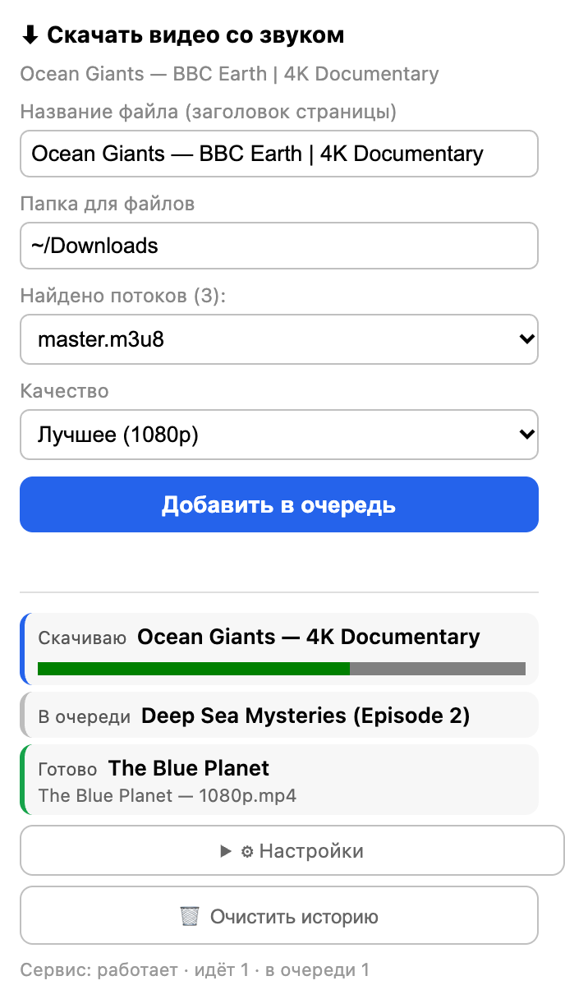

# Скачать видео со звуком · Video Saver with Sound

> Расширение для Chrome/Vivaldi + локальный сервис (macOS), которые находят HLS-потоки
> страницы и скачивают видео **вместе с аудио** через `yt-dlp`.
>
> A Chrome/Vivaldi extension plus a tiny local macOS service that finds the page's HLS
> streams and downloads video **with audio** via `yt-dlp`.

[Полная английская версия / Full English version](#english-readme)



---

## Что это

- Расширение **само находит** потоки на странице (перехватывает `.m3u8`, которые грузит
  плеер, даже через JS) — не нужно копировать ссылки из кода страницы.
- Локальный Python-сервис качает через `yt-dlp`, берёт видео **и** аудио-дорожки отдельно
  и склеивает их в один MP4. Решает типовую проблему «скачал, а звука нет» (DASH/HLS).
- Попап показывает **очередь и историю** загрузок (живёт на сервере, переживает навигацию),
  настраиваются: число одновременных загрузок, добавление тега стрима к имени, папка
  сохранения.

## Как это работает

```
[Страница с видео]  ──(перехват сети)──▶  Расширение (background.js)
      │                                        │
      │  content.js ищет .m3u8 в DOM/performance │
      ▼                                        ▼
   Попап (popup.js) ◀── потоки ── runtime.sendMessage
      │  ▶ POST /download {url, format, name, save_dir}
      ▼
Локальный Python-сервис (server.py)
   - очередь заданий (до max_concurrent параллельно)
   - yt-dlp -f "bv*+ba/b" --merge-output-format mp4  (видео + аудио → один MP4)
   - прогресс и имя файла из stdout
   - настройки в settings.json
      │
      ▼
  MP4 (видео + аудио) в выбранной папке (по умолчанию ~/Downloads)
```

### Ключевые решения

- **Адресная строка в yt-dlp не передаётся**: многие VOD-плееры и образовательные сайты
  yt-dlp напрямую не поддерживает. Расширение находит на странице *реальные* HLS-потоки:
  `background.js` слушает `webRequest` вкладки и запоминает `.m3u8` (в том числе те, что
  грузятся через JS), а `content.js` дополнительно сканирует DOM и
  `performance.getEntriesByType("resource")`.
- **Видео и аудио отдельно**: `-f "bv*+ba/b"` — yt-dlp берёт лучшие видео- и аудио-дорожки
  и склеивает их в один MP4 (нужен `ffmpeg`). Это и решает проблему «скачал, а звука нет».
- **Очередь живёт на сервере**, а не в расширении: она переживает перезагрузки вкладок,
  навигацию и закрытый попап. `/jobs` отдаёт и активные задания, и историю.
- **Имя файла = заголовок страницы** (поле в попапе), спецсимволы очищаются, опционально
  добавляется короткий тег стрима, чтобы одинаковые заголовки не перезаписывали друг друга.
- Если выбран `media_N.m3u8` (только видео) — сервис сам попробует заменить его на
  `master.m3u8`, чтобы в загрузке был звук.

Подробности — в [docs/ARCHITECTURE.md](docs/ARCHITECTURE.md).

## Требования

- **macOS** (расширение шлёт запросы на `localhost:8765`, где крутится локальный сервис)
- Python 3.9+
- [yt-dlp](https://github.com/yt-dlp/yt-dlp) (`brew install yt-dlp`)
- [ffmpeg](https://ffmpeg.org/) для склейки видео и аудио (`brew install ffmpeg`)
- Chrome / Vivaldi / любой Chromium-браузер

## Установка

### 1. Сервис (один раз)

```bash
git clone https://github.com/AzamatMurra/video-saver-browser.git
cd video-saver-browser
chmod +x install.sh
./install.sh
```

Скрипт копирует код в `~/.local/share/video-saver`, регистрирует launchd-агент и запускает
сервис. Проверка:

```bash
curl http://localhost:8765/   # → {"ok":true,...}
```

### 2. Расширение (один раз)

1. Тот же клон: сервис уже установлен, папка расширения — `extension/`.
2. Откройте `chrome://extensions` (в Vivaldi — `vivaldi://extensions`).
3. Включите «Режим разработчика» → «Загрузить распакованное расширение» → папка `extension/`.
4. Закрепите иконку на панели (опционально).

## Использование

1. Откройте страницу с видео, дайте плееру начать проигрывание (тогда `.m3u8` будут пойманы).
2. Клик по иконке → выберите поток (`master.m3u8` обычно с аудио), качество, при желании
   поменяйте имя файла и папку → **«Добавить в очередь»**.
3. Загрузки идут по очереди (лимит настраивается), статусы и прогресс видны в попапе,
   список — это же история, есть кнопка «Очистить историю».
4. Готовый файл появляется в выбранной папке (по умолчанию `~/Downloads`).

## Настройки

| Параметр | Что делает |
|---|---|
| Одновременных загрузок | лимит параллельных задач (1–5) |
| «Добавлять тег стрима к имени файла» | при выключении в имени нет тега (осторожно: одинаковые заголовки перезапишутся) |
| Папка для файлов | каталог сохранения (создаётся автоматически, запоминается) |

## Полезные команды

- Лог сервиса: `~/.local/share/video-saver/server.log`
- Перезапуск сервиса: `launchctl kickstart -k gui/$(id -u)/com.user.video-saver`
- Отключить автозапуск: `launchctl bootout gui/$(id -u)/com.user.video-saver`

## Ограничения

Расширение завязано на локальный сервис на этом Mac — оно не «облачное»: скачивание идёт
на компьютер, где установлен сервис.

## Внутренности

- Как всё устроено — [docs/ARCHITECTURE.md](docs/ARCHITECTURE.md)
- История версий — [docs/CHANGELOG.md](docs/CHANGELOG.md)

## Лицензия

[MIT](LICENSE)

---

## English readme

`Video Saver with Sound` — a Chrome/Vivaldi extension plus a tiny local macOS service that
finds the page's HLS streams and downloads video **with audio** via `yt-dlp`.


### What it does

- The extension **finds the streams by itself**: it intercepts the `.m3u8` playlists the
  player loads (even when they are fetched via JS), so you never have to dig links out of
  the page source.
- The local Python service downloads with `yt-dlp`, pulling the **video and audio tracks
  separately** and merging them into a single MP4. It solves the classic
  "downloaded it, but there's no sound" problem (DASH/HLS).
- The popup shows a **download queue and history** (stored server-side, so it survives
  navigation and closed popups) with configurable parallel downloads, an optional stream
  tag in the filename, and a chosen save folder.

### How it works

```
[Video page] ──(network interception)──▶ Extension (background.js)
      │                                        │
      │  content.js scans DOM / performance   │
      ▼                                        ▼
   Popup (popup.js) ◀── streams ── runtime.sendMessage
      │  ▶ POST /download {url, format, name, save_dir}
      ▼
Local Python service (server.py)
   - persistent job queue (up to max_concurrent in parallel)
   - yt-dlp -f "bv*+ba/b" --merge-output-format mp4  (video + audio → one MP4)
   - progress & filename parsed from stdout
   - settings in settings.json
      │
      ▼
  MP4 (video + audio) in your chosen folder (default: ~/Downloads)
```

Key ideas:

- The address-bar URL is **never** sent to `yt-dlp`. Many VOD players and educational
  sites aren't supported by yt-dlp directly, so the extension finds the *real* HLS
  streams on the page instead (`background.js` watches the tab's `webRequest` traffic,
  `content.js` also scans the DOM and `performance` resource entries).
- Video and audio are downloaded separately (`-f "bv*+ba/b"`) and merged into one MP4 —
  this is what fixes the "no sound" problem on DASH/HLS sites. Requires `ffmpeg`.
- The queue lives **on the server**, not in the extension, so it survives tab reloads,
  navigation and closed popups. `/jobs` returns both active jobs and history.
- The filename defaults to the page title (sanitized), with an optional short stream tag
  appended to avoid overwriting different videos with identical titles.
- If you pick a `media_N.m3u8` (video-only) stream, the service automatically tries to
  upgrade it to `master.m3u8` so the download includes audio.

Details — see [docs/ARCHITECTURE.md](docs/ARCHITECTURE.md).

### Requirements

- **macOS** (the extension talks to the local service on `localhost:8765`)
- Python 3.9+
- [yt-dlp](https://github.com/yt-dlp/yt-dlp) (`brew install yt-dlp`)
- [ffmpeg](https://ffmpeg.org/) for merging video and audio (`brew install ffmpeg`)
- Chrome / Vivaldi / any Chromium-based browser

### Install

#### 1. Service (once)

```bash
git clone https://github.com/AzamatMurra/video-saver-browser.git
cd video-saver-browser
chmod +x install.sh
./install.sh
```

This copies the code to `~/.local/share/video-saver`, registers a launchd agent and starts
the service. Verify it's up:

```bash
curl http://localhost:8765/   # → {"ok":true,...}
```

#### 2. Extension (once)

1. Use the same clone — the service is already installed, the extension lives in `extension/`.
2. Open `chrome://extensions` (in Vivaldi: `vivaldi://extensions`).
3. Enable **Developer mode** → **Load unpacked** → select the `extension/` folder.
4. Optionally pin the icon to the toolbar.

### Usage

1. Open a page with a video and let the player start playing — that's when the `.m3u8`
   playlists get captured.
2. Click the extension icon → pick a stream (`master.m3u8` usually carries audio), choose
   quality, and optionally rename the file / pick a folder → **Add to queue**.
3. Downloads run as a queue (parallel limit is configurable); statuses and progress are
   shown in the popup. The list doubles as history — there's a **Clear history** button.
4. The finished file appears in the chosen folder (default `~/Downloads`).

### Settings

| Setting | What it does |
|---|---|
| Concurrent downloads | limit of parallel jobs (1–5) |
| Add stream tag to filename | when off, the stream tag is omitted from the name (caution: identical titles would overwrite each other) |
| Download folder | save directory (auto-created, remembered) |

### Useful commands

- Service log: `~/.local/share/video-saver/server.log`
- Restart the service: `launchctl kickstart -k gui/$(id -u)/com.user.video-saver`
- Disable autostart: `launchctl bootout gui/$(id -u)/com.user.video-saver`

### Limitations

The extension is bound to the local service running on this Mac — it is **not**
"cloud": downloads happen on the machine where the service is installed.

### Internals

- How everything works — [docs/ARCHITECTURE.md](docs/ARCHITECTURE.md)
- Version history — [docs/CHANGELOG.md](docs/CHANGELOG.md)

### License

[MIT](LICENSE)
